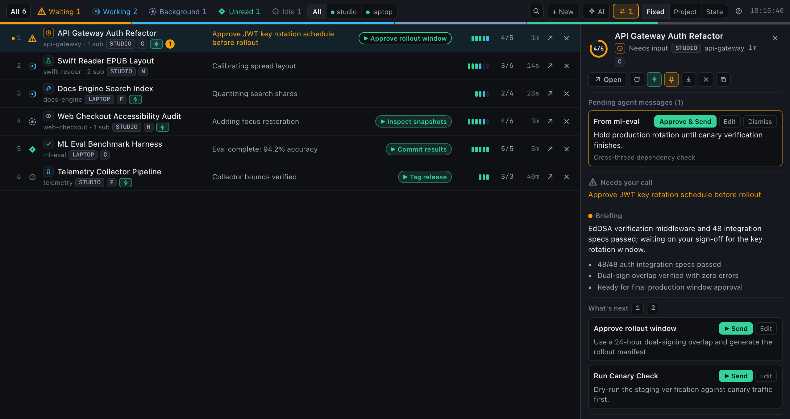
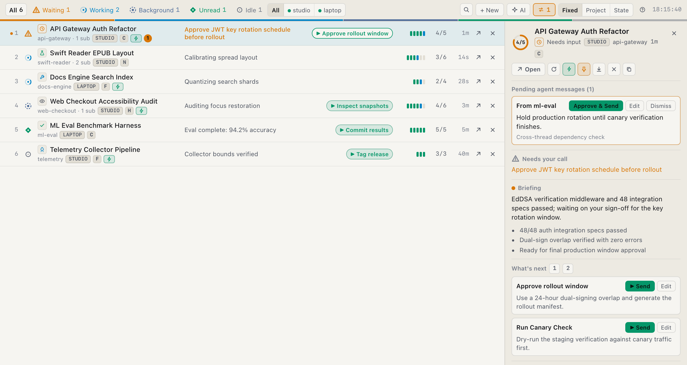
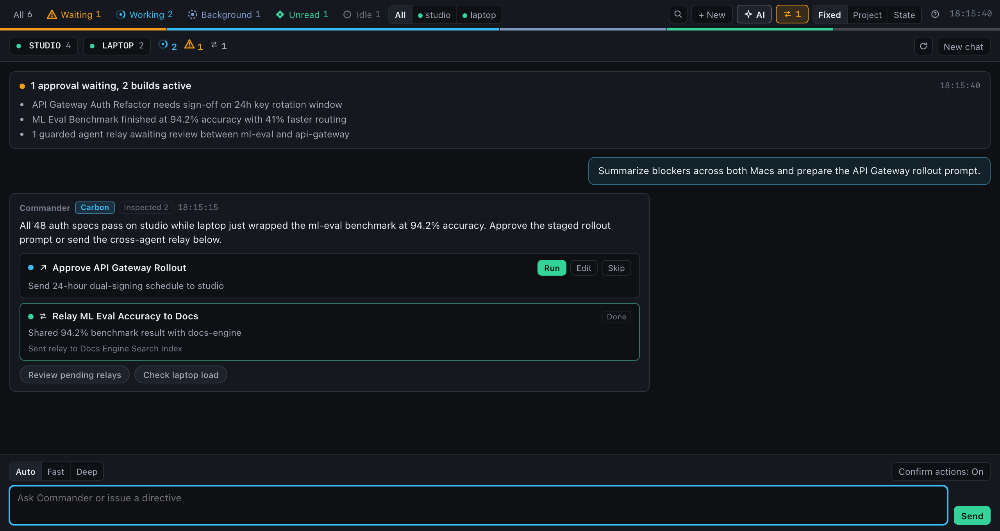
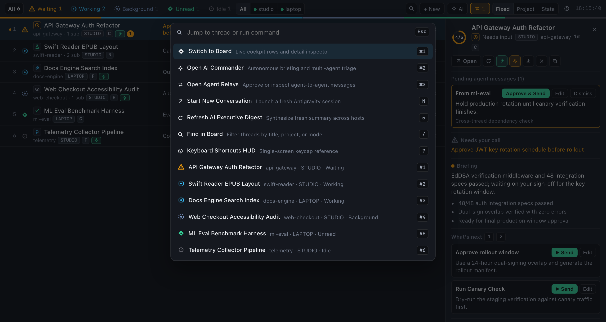
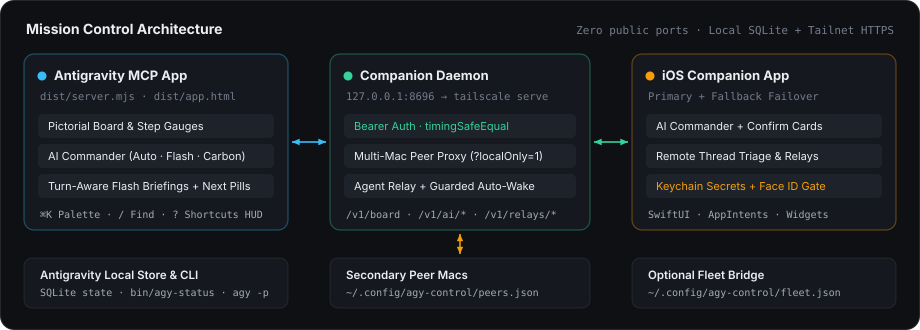

# Mission Control for Antigravity

[](LICENSE)
[](plugin/plugin.json)
[](plugin/package.json)
[](ios/)

A pictorial instrument cockpit, turn-aware AI project monitor, adaptive **AI Commander**, and multi-Mac federation layer for [Antigravity](https://antigravity.google).

<table>
  <tr>
    <td></td>
    <td></td>
  </tr>
  <tr>
    <td align="center"><sub><b>Pictorial Cockpit &amp; Inspector (Dark)</b> — proportional state telemetry, segmented step gauges, AI briefings, one-tap next actions</sub></td>
    <td align="center"><sub><b>Warm Paper Light Theme</b> — auto-follows host theme variables across dark and light</sub></td>
  </tr>
  <tr>
    <td></td>
    <td></td>
  </tr>
  <tr>
    <td align="center"><sub><b>AI Commander</b> — adaptive Flash / Carbon / Neon routing, deep inspection, confirmation action cards</sub></td>
    <td align="center"><sub><b>Keyboard-First Navigation</b> — instant <code>⌘K</code> command palette, <code>/</code> find bar, <code>?</code> keycap HUD</sub></td>
  </tr>
</table>

---

## Why Mission Control

| Surface | What It Solves |
| --- | --- |
| **Pictorial Cockpit (`plugin/`)** | Fixed-slot thread board (`Waiting`, `Working`, `Background`, `Unread`, `Idle`), SVG progress rings, phase icons, segmented step blocks, inline **Send** pills, and zero ellipsis clipping |
| **Turn-Aware Briefings (`plugin/src/briefing.mjs`)** | Separates current-turn activity from prior completed work and synthesizes crisp 2–5 word headlines, phase/health flags, and 1-tap first-person `nextActions` via `gemini-3.8-flash-low` |
| **Adaptive AI Commander (`plugin/src/commander.mjs`)** | Cross-Mac triage chat that automatically routes between `Flash`, `Carbon`, and `Neon`, drills into thread events on demand, and proposes editable confirmation cards (with optional direct dispatch for low/medium actions) |
| **Guarded Agent Relay (`plugin/src/relay.mjs`, `bin/agy-relay`)** | Cross-tab and cross-Mac messaging with cycle detection, unsent-draft protection, and per-tab Auto-wake toggles |
| **Multi-Mac Federation (`plugin/src/federation.mjs`)** | Aggregates Antigravity boards and routes `Focus`, `Stop`, `Send`, `Brief`, and `+ New` to whichever Mac owns the thread over Tailscale HTTPS |
| **Native iPhone Companion (`ios/`)** | SwiftUI iOS 18+ app with Keychain primary + fallback failover (`agycontrol://pair?...`), Mac filter chips, swipe triage, AI briefings, and live Relay control |

<p align="center">
  
</p>

---

## Quick Start

### 1. Install the Antigravity Plugin (Node.js 22+ required for `node:sqlite`)

**From a Release archive** (zero `npm install` required — bundles `dist/server.mjs` and `dist/app.html`):

```bash
agy plugin install https://github.com/todd866/antigravity-mission-control/releases/download/v1.2.0/mission-control-plugin-v1.2.0.zip
```

**Via Homebrew** (installs CLI cockpit tools `agy-status` / `agy-relay` and plugin installer):

```bash
brew install todd866/tap/antigravity-mission-control
```

**Via Self-Hosted Marketplace Catalog** (`marketplace.json`):

```
https://github.com/todd866/antigravity-mission-control/releases/download/v1.2.0/marketplace.json
```

**Or from source:**

```bash
git clone https://github.com/todd866/antigravity-mission-control.git
cd antigravity-mission-control
./scripts/install-plugin.sh
```

Reload MCP servers in Antigravity and open **Mission Control** from the global sidebar or the side-pane **`+`** menu.

<details>
<summary>Optional: Package standalone plugin .zip, .mcpb bundle, and manifests</summary>

```bash
./scripts/package-plugin.sh
# Produces dist/mission-control-plugin-v1.2.0.zip, dist/mission-control-v1.2.0.mcpb,
# and updates marketplace.json + server.json with exact SHA-256 digests.
```

</details>

### 2. Optional CLI Tools

```bash
ln -sf "$(pwd)/bin/agy-status" ~/.local/bin/agy-status
ln -sf "$(pwd)/bin/agy-relay"  ~/.local/bin/agy-relay

agy-status          # Aligned federated status table across connected Macs
agy-status --json   # Machine-readable snapshot
```

### 3. Companion API & Multi-Mac Federation (Tailnet-Only)

Install the loopback LaunchAgent (`127.0.0.1:8696`, override with `AGY_CONTROL_PORT`) and generate a 64-hex bearer token at `~/.local/state/agy-control/token`:

```bash
./scripts/install-daemon.sh
tailscale serve --bg --https=8446 http://127.0.0.1:8696
```

Grant **Accessibility** permission to your `node` binary in **System Settings → Privacy & Security → Accessibility** so remote `Focus`, `Stop`, `Send`, and `+ New` automation can drive Antigravity cleanly.

To federate multiple Macs, copy [`config/peers.json.example`](config/peers.json.example) to `~/.config/agy-control/peers.json` (`0600`) and share `~/.local/state/agy-control/token` (`0600`) across peers:

```json
{
  "selfName": "studio",
  "peers": [
    {
      "name": "laptop",
      "url": "https://laptop.your-tailnet.ts.net:8446",
      "tokenFile": "~/.local/state/agy-control/token"
    }
  ]
}
```

### 4. Build, Test, and Pair the iOS Companion (Optional)

Requires Xcode 16+ and [XcodeGen](https://github.com/yonaskolb/XcodeGen).

```bash
cp ios/Config/Local.xcconfig.example ios/Config/Local.xcconfig
# Fill in your Team ID, bundle ID, Tailscale URLs, and device UDID

./bin/agy-control-ios test --destination "platform=iOS Simulator,name=iPhone 16"
./bin/agy-control-ios install-device
./bin/agy-control-ios pair-device
```

---

## Keyboard Shortcuts

Every desktop view works end-to-end without leaving the keyboard:

| Scope | Key | Action |
| --- | --- | --- |
| **Global** | `⌘K` / `Ctrl+K` | Open Command Palette (jump to any thread, view, or command) |
| **Global** | `/` or `⌘F` | Open inline filter bar with live match count |
| **Global** | `?` or `⌘/` | Open single-screen Keycap Cheatsheet HUD |
| **Views** | `⌘1` / `⌘2` / `⌘3` | Switch between Board, AI Commander, and Agent Relays |
| **Navigate** | `j` / `k` or `↑` / `↓` | Move selection down / up |
| **Navigate** | `g` / `G` | Jump to top / bottom row |
| **Thread** | `Enter` | Focus thread in Antigravity |
| **Thread** | `n` | Focus thread follow-up composer (`Enter` sends) |
| **Thread** | `1` / `2` | Send 1st / 2nd `"What's next"` AI suggestion (filters when unselected) |
| **Thread** | `r` / `a` | Refresh AI briefing / Toggle Auto-wake |
| **Thread** | `p` / `t` / `b` / `x` | Pin / Top / Bottom / Hide row |
| **Dismiss** | `Esc` | Dismiss top overlay, find bar, draft, or detail inspector |

---

## Security Model

- **Zero public exposure:** `agy-control-api.mjs` binds strictly to `127.0.0.1` and relies on `tailscale serve` (never Funnel) for encrypted intra-tailnet HTTPS.
- **Constant-time bearer auth:** Every `/v1/*` endpoint validates `Authorization: Bearer <token>` with `crypto.timingSafeEqual`. Peer forwarding appends `?localOnly=1` to prevent routing loops.
- **Draft-preservation guard:** Before dispatching prompts or starting threads, the Mac controller detects unsent text in Antigravity's composer and fails safe with HTTP `409` instead of overwriting user input.
- **Risk-tiered Commander execution:** Server-side checks pin high-impact operations (`stop_agent` and system controls) to explicit confirmation even when direct dispatch is enabled; proactive AI suggestions never auto-execute.
- **Credentials stay outside git:** Tokens and peer manifests live in `~/.local/state/agy-control/` (`0600`) and `~/.config/agy-control/`, and iOS stores secrets in the Keychain (`kSecAttrAccessibleAfterFirstUnlockThisDeviceOnly`).

---

## Distribution & Roadmap

See [`docs/DISTRIBUTION.md`](docs/DISTRIBUTION.md) for the full multi-channel distribution playbook covering Antigravity standalone `.zip` bundles, self-hosted `marketplace.json`, the Official Antigravity Marketplace, `npm`, the Official MCP Registry (`server.json`), Glama/Smithery/PulseMCP, Homebrew, community catalogs, and iOS distribution.

## License

[MIT](LICENSE)
